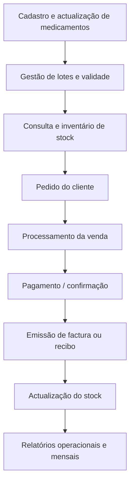

# Fluxo operacional de alto nível

O fluxo sintetiza as actividades descritas no caso. A ordem exacta de confirmação de pagamento, emissão fiscal e baixa de stock deve ser validada com as regras operacionais e legais aplicáveis.
